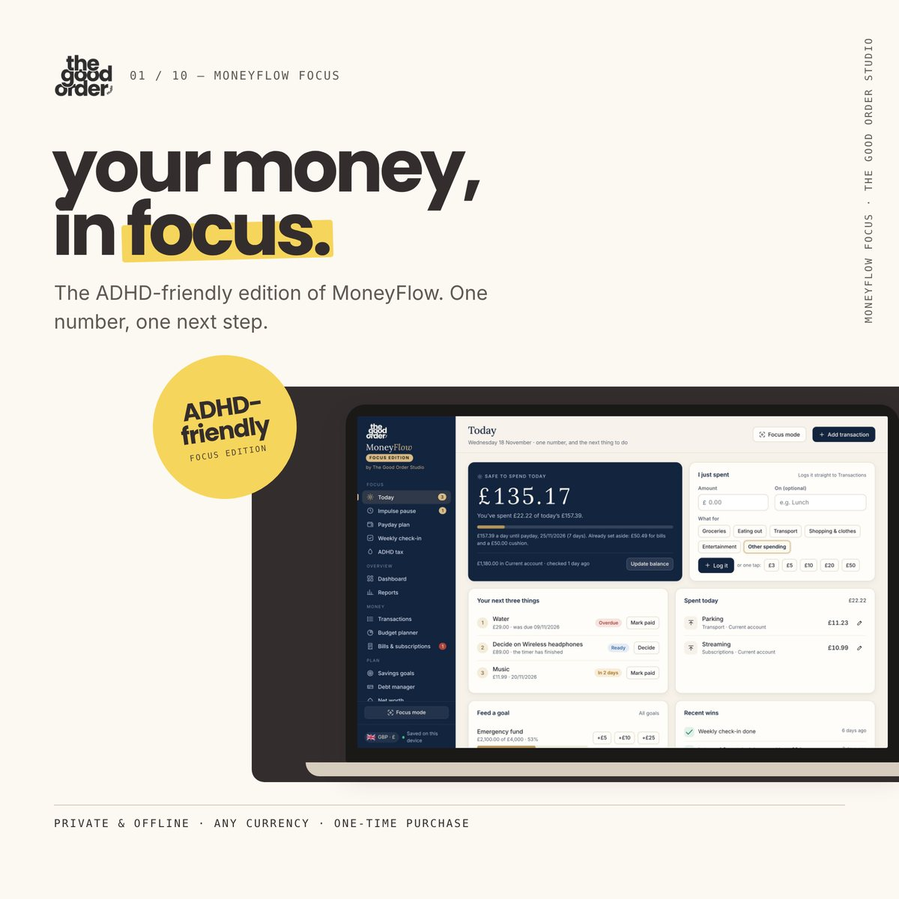
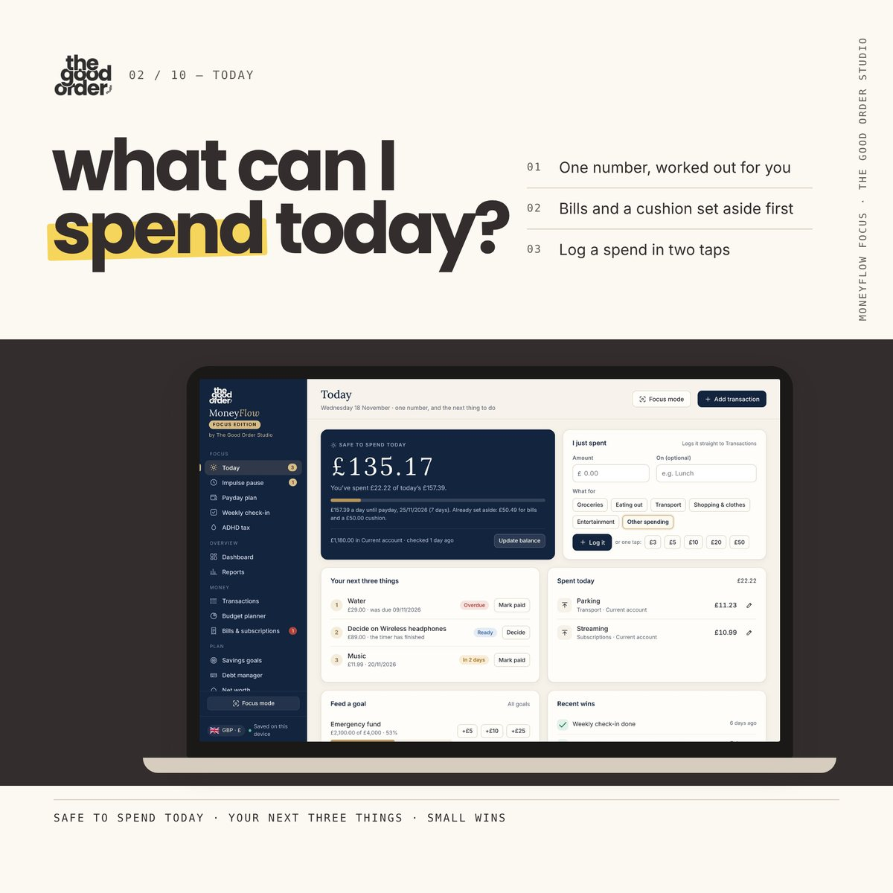
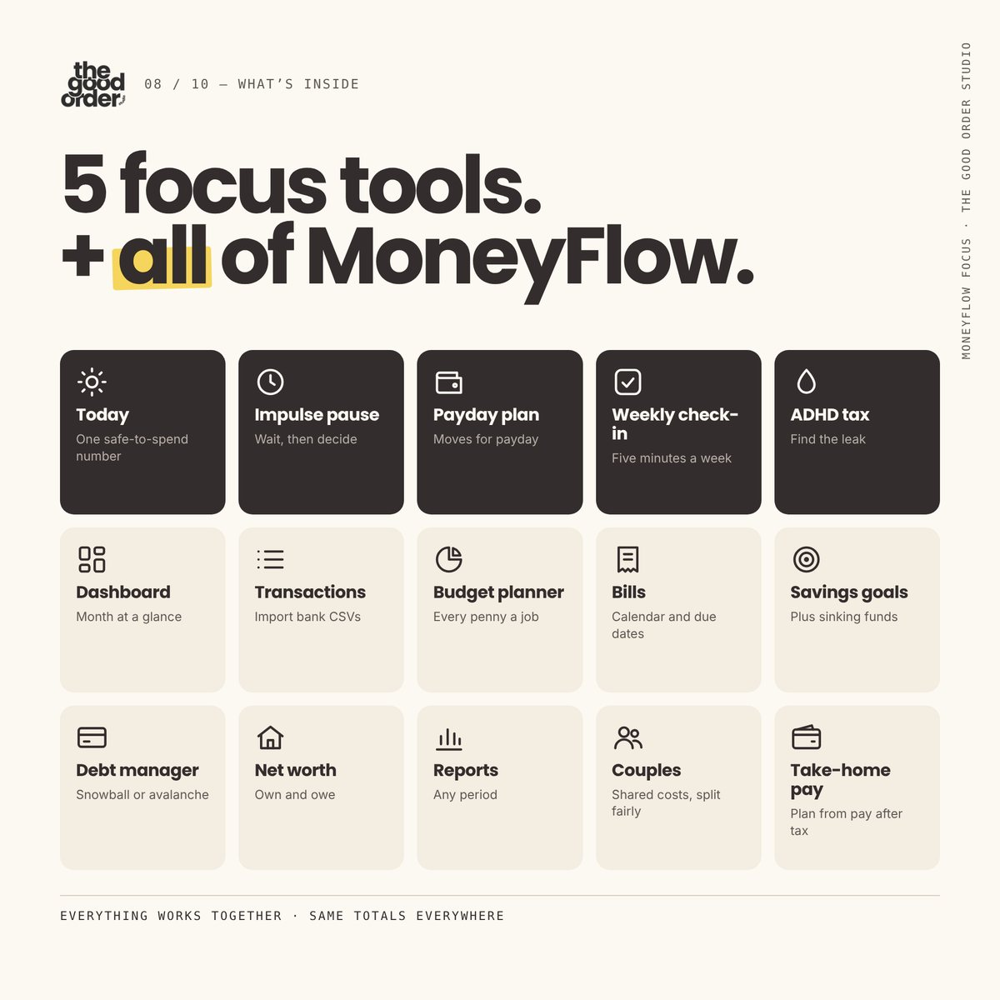

# MoneyFlow Focus — free demo

your money, in focus.

This is the free demo of MoneyFlow Focus by The Good Order Studio, the ADHD-friendly edition of MoneyFlow: one number for what you can safely spend today, one next step, and the full budgeting toolkit when you want it.

▶ Try it: https://thegoodorderstudio.github.io/moneyflow-focus-demo/

- Explore with fictional sample data, or as an individual or a couple
- Try Today, Impulse pause, Payday plan, the weekly check-in, the ADHD tax tracker and Focus mode
- Nothing to install, no account, and nothing is sent to a server
- Best on a computer, in Chrome, Edge, Firefox or Safari

The full version, with the Excel and Google Sheets editions and step-by-step guides, is available from The Good Order Studio.

---

© 2026 The Good Order Studio. All rights reserved.

MoneyFlow Focus is original, copyrighted work. This demo is for trying MoneyFlow Focus in your browser only. It is **not open source**: copying, modifying, reselling, rebranding, re-hosting or using it, its code or its images to make other products is not permitted. See [LICENSE](LICENSE).
